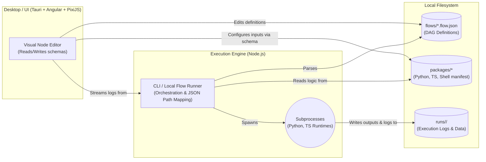

# Architecture of MagnetarArachne

This document describes the high-level structure of the MagnetarArachne system, its components, and key design decisions.

## 🏛️ High-Level Diagram

The following text-based flowchart illustrates the primary interactions between the core components of the visual workflow automation platform.

## 🧩 Component Descriptions

MagnetarArachne is built on a simple, scalable, and file-first architecture. It relies on the local file system rather than complex external databases (like Redis or PostgreSQL) to manage state, enabling portability.

### 1. Visual Node Editor (Frontend)
*   **Responsibility:** Provides the drag-and-drop interface for users to construct, connect, and configure Directed Acyclic Graphs (DAGs) representing their automation workflows.
*   **Technologies:** Angular 18+ (using Signals for reactivity) and PixiJS (WebGL) to handle the complex rendering of thousands of nodes and edges smoothly.

### 2. Desktop Shell (Tauri)
*   **Responsibility:** Packages the Angular application into a native desktop executable, granting it the necessary permissions to read/write files and execute local binaries (Node, Python).
*   **Technologies:** Tauri 2.0+ (Rust-based native shell).

### 3. CLI / Local Flow Runner (Node.js)
*   **Responsibility:** The core orchestration engine. It parses `.flow.json` files, determines the topological execution order, resolves JSON-Path dependencies (e.g., mapping `$.nodeA.output` to `nodeB.input`), and manages the lifecycle of executing nodes.
*   **Technologies:** Node.js, utilizing standard child process spawning mechanisms.

### 4. Package System
*   **Responsibility:** Defines atomic units of work. A package is a directory containing an `arachne.package.json` manifest (which defines schemas for config, inputs, and outputs) and an entry script.
*   **Technologies:** Packages can be written in Python, TypeScript, or Shell scripts. The schemas dictate how the frontend UI renders forms for each node.

### 5. Execution State & File System
*   **Responsibility:** Acts as the primary data store for the application. Flow definitions, custom user nodes, and the results of executions (logs, intermediate inputs/outputs) are all stored directly on the file system under specific directories (`flows/`, `packages/`, `runs/`).
*   **Technologies:** Standard JSON serialization and local OS file storage.