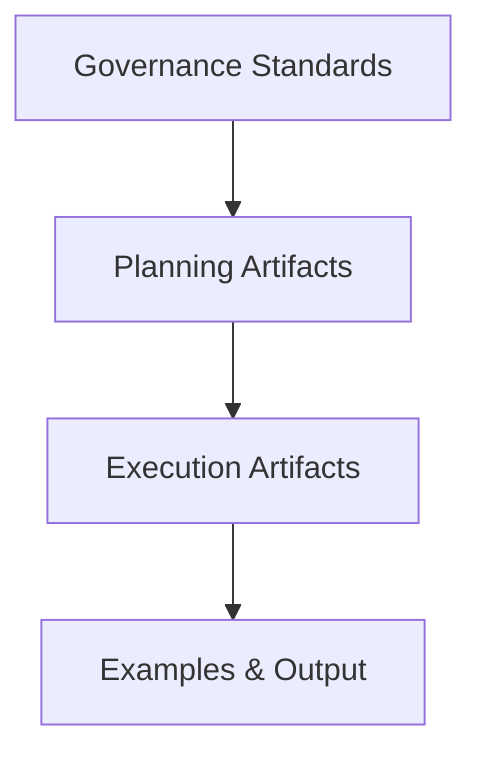

# Canonical Project Model of MagnetarArachne

<div align="center">
  
  <h3>🕷️ Visual Workflow Automation Platform</h3>
  <p>A file-first, extensible visual automation platform for workflows and data pipelines, built with Angular, Tauri, and Node.js.</p>
</div>

---

## 📖 Canonical Project Model Purpose

MagnetarArachne exists to provide a file-first, extensible visual automation platform for workflows and data pipelines. It solves the complexity of orchestrating multiple scripts and systems by offering a high-performance visual node editor and a simple, local, Node-based runner.

This project rigorously follows the **Magnetar standard** for documentation, planning, and governance. This canonical model guarantees transparency, trackability, and seamless collaboration between human developers and AI agents.

## 🛠️ How to Use This Repository

To effectively engage with this repository, users and collaborators must adhere to the following steps:
1. **Clone the canonical model** and familiarize yourself with the structure.
2. **Copy and fill out** the `projects/_template.project.yml` file with your specific execution configuration when starting a new initiative.
3. **Replicate the required documentation set** if initiating a new major component or derived project.
4. **Follow the WIP, branching, and blocker rules** detailed in the governance files.
5. **Consult the example project** or existing nodes to resolve questions about implementations.

## 📂 Project Contents

The project relies on a definitive set of canonical documents. Their presence and upkeep are mandatory.

| File | Purpose |
|------|---------|
| `PLAN.md` | Project tasks & milestones. |
| `BITACORA.md` | Chronological logbook. |
| `REQUIREMENTS.md` | Functional & non-functional specs. |
| `ARCHITECTURE.md` | System/module structure. |
| `RULES.md` | Naming & workflow standards. |
| `STATUS.md` | Health summary & progress stats. |
| `TESTING.md` | Test coverage & reporting rules. |
| `BLOCKERS.md` | Documented blockers & escalation paths. |

*Note: For governance references, please also see `BRANCHING_MODEL.md`, `WIP_GUIDELINES.md`, and `CONTRIBUTING.md`.*

## 📈 Progress Model Overview

The project tracks progress strictly through milestones, tasks, and state transitions. Tasks must flow through the following states: `planned` → `in_progress` → `in_review` → `done`.
**Every single state change must be permanently recorded in `BITACORA.md`.**

## 📄 YAML Project Schema

The `projects/_template.project.yml` file serves as the canonical machine-readable schema for the project. It explicitly contains metadata, stakeholders, milestones, tasks, and risks, enabling automated parsing and reporting.

## 🤖 Guidance for AI Collaborators

If you are an AI agent collaborating on this project, you must:
* Parse the project YAML file before acting.
* Use `PLAN.md` and `STATUS.md` to determine your focus.
* Respect `RULES.md`, `WIP_GUIDELINES.md`, and `BRANCHING_MODEL.md`.
* Update `BITACORA.md` chronologically after completing any work or altering state.

## 🏛️ Architecture Diagram (Canonical Flow)



## 📝 Applying This Template

If you are applying this structure to a new initiative:
1. Copy the repository structure.
2. Replace placeholder content with project-specific details.
3. Instantiate and validate a project YAML file.
4. Establish initial milestones and log the initial state in `PLAN.md`, `STATUS.md`, and `BITACORA.md`.

## ✅ Validating Canon Compliance

To confirm that this project (or a sub-project) follows the Magnetar canon, ensure that:
- [ ] All required files exist.
- [ ] The project YAML matches the schema.
- [ ] `BITACORA.md` is updated chronologically.
- [ ] Active branches follow the `BRANCHING_MODEL.md` rules.
- [ ] Testing commitments and blocker processes match `TESTING.md` and `BLOCKERS.md`.

---

## 🚀 Key Features

- **🎨 Visual Node Editor**: A high-performance canvas (PixiJS) to design workflows via drag-and-drop
- **📦 Package-Centric Design**: Everything is defined in portable, self-contained packages (JSON manifests + code)
- **🔌 Plugin System**: Add new capabilities by dropping packages into your project (Python, TypeScript, Shell, etc.)
- **🧩 Embedded Packages**: Build complex pipelines by embedding other packages
- **🤖 AI-Ready**: Pre-built packages for LLMs (OpenAI, Anthropic) and vector databases
- **💬 Human-in-the-Loop**: Special chat nodes to pause execution and collect user input
- **🖥️ Cross-Platform**: Desktop (Tauri) and optional web interface
- **📂 File-First Execution**: No mandatory databases or queues; flows, logs, and runs are stored as simple files
- **⚡ Lightweight Runner**: A simple, Node-based orchestrator runs flows locally without external dependencies

---

## 🏗️ Project Structure

```
MagnetarArachne/
├── apps/
│   ├── desktop/          # 🎨 Angular Desktop App (with Tauri)
│   └── tools/runner/     # ⚙️ CLI/Local Flow Runner
├── libs/
│   ├── shared-types/     # 📝 Shared TypeScript Interfaces
│   └── ui-kit/           # 🧩 Reusable UI Components
└── packages/             # 🔌 Built-in packages (Python, TS, Shell, AI, etc.)
```

---

## 🛠️ Technology Stack

| Layer                 | Tech Stack                                                   |
|----------------------|-------------------------------------------------------------|
| **Frontend**         | Angular 18+ (Signals) + PixiJS (WebGL)                       |
| **Desktop**          | Tauri 2.0+ (Native Shell)                                    |
| **Runner/CLI**       | Node.js (spawns Python/TS/Shell subprocesses)                |
| **Orchestration**    | JSON/YAML DAG Definitions, Topological Execution             |
| **State/Schema**     | JSON Schema-driven UI, Configurable per package              |
| **Monorepo**         | Nx Workspace                                                |
| **Optional Backend** | NestJS server (future) for multi-user & remote execution    |

---

## 📦 Package Specification

A package is a self-contained directory with a manifest and executable script.

**Example structure:**
```
packages/pkg.python.hello/
├── arachne.package.json   # Package manifest
├── execute.py             # Execution script
└── requirements.txt       # (Optional) Dependencies
```

**Manifest example (`arachne.package.json`):**
```json
{
  "name": "pkg.python.hello",
  "version": "0.1.0",
  "language": "python",
  "entry": "execute.py",
  "schemas": {
    "config": { "type": "object", "properties": { "greeting": { "type": "string" } } },
    "inputs": { "type": "object", "properties": { "name": { "type": "string" } } },
    "outputs": { "type": "object", "properties": { "message": { "type": "string" } } }
  },
  "embedded": [],
  "env": ["OPENAI_API_KEY"],
  "install": { "python": "pip install -r requirements.txt" }
}
```

---

## 🌐 Flows & Orchestration

* Flows are **Directed Acyclic Graphs (DAGs)** defined in `.flow.json` files
* Execution is **file-first**: all inputs, outputs, and logs are stored under `runs/`
* No Redis or database is required for execution
* Mapping between nodes is **JSON-Path based** (`"$.nodeId.output.field"`)

**Example:**

```json
{
  "name": "email-campaign",
  "nodes": [
    { "id": "n1", "package": "pkg.python.hello", "config": { "greeting": "Hello" } },
    { "id": "n2", "package": "pkg.ts.transform" }
  ],
  "edges": [
    { "from": "n1", "to": "n2", "map": { "text": "$.n1.output.message" } }
  ]
}
```

---

## 🖥️ Execution Flow

```mermaid
flowchart LR
  UI[Angular + PixiJS (Tauri)] -- edits --> FLOWS[(flows/*.flow.json)]
  UI -- manages --> PKGS[(packages/*)]
  CLI[arachne runner] --> PROC1[Python/TS/Shell subprocesses]
  PROC1 --> RUNS[(runs/<flow>/<timestamp>)]
  UI <-- streams logs --> CLI
```

---

## 🚀 Quick Start

### Prerequisites

* Node.js 18+
* npm
* Python 3.9+ (for Python packages)
* Git

### Install

```bash
git clone https://github.com/your-username/MagnetarArachne.git
cd MagnetarArachne
npm install
```

### Run

```bash
# Run a flow
npx tsx tools/runner/src/index.ts run flows/example.flow.json
```

---

## 🗺️ Roadmap

| Phase | Goal                                            |
| ----- | ----------------------------------------------- |
| 1     | CLI runner: Run flows with Python + TS packages |
| 2     | Angular editor: Visual DAG editor (PixiJS)      |
| 3     | Human-in-the-loop & AI packages                 |
| 4     | Packaging system: `.apkg` for shareable bundles |
| 5     | Tauri desktop app (file-based projects)         |
| 6     | Optional NestJS backend (multi-user/remote)     |

---

## 🔌 Developing Packages

* Packages can be **Python**, **TypeScript**, or **Shell**
* Inputs/outputs are JSON-based
* Easy testing and installation with `arachne pack` and `arachne add`
* Embedding other packages is supported via `"embedded"`

---

## 🤝 Contributing

1. Fork the repository
2. Create a feature branch (`git checkout -b feature/MyFeature`)
3. Commit changes (`git commit -m 'Add MyFeature'`)
4. Push branch (`git push origin feature/MyFeature`)
5. Open a Pull Request

---

## 📄 License

MIT License. See `LICENSE` for details.

---

<div align="center">
  <p>🕷️ Built with ❤️ and Nx Workspace</p>
</div>
